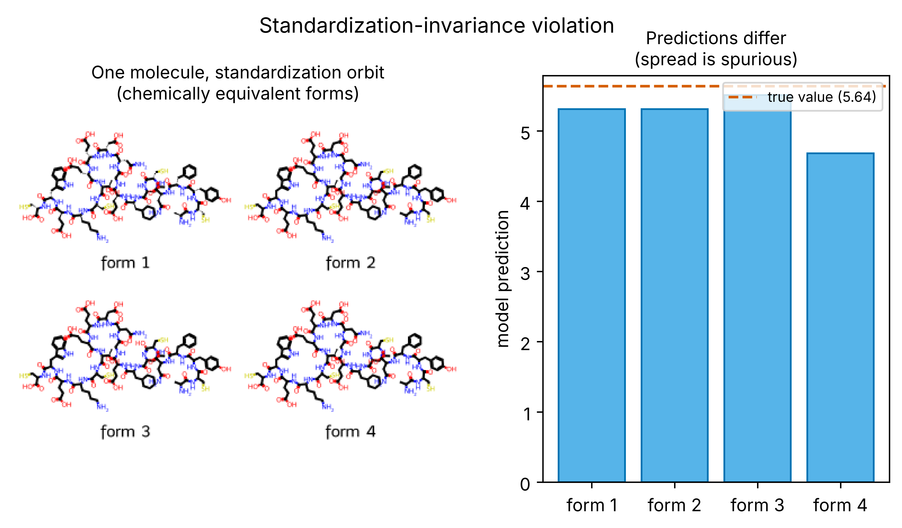
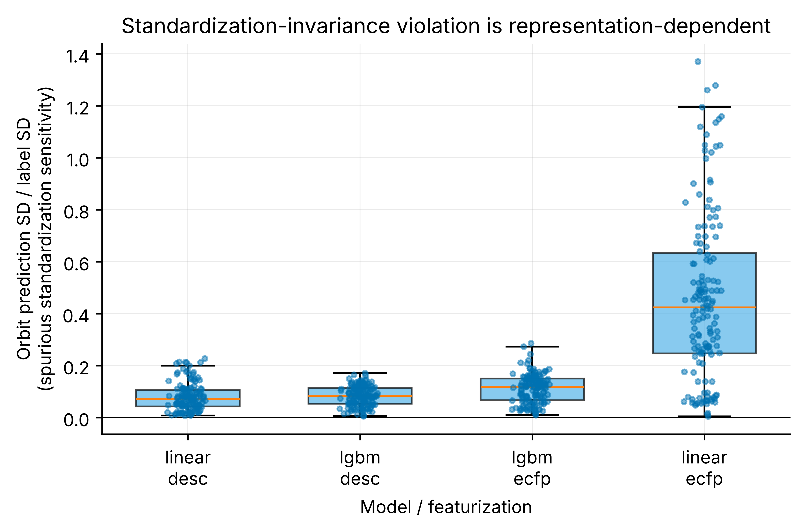
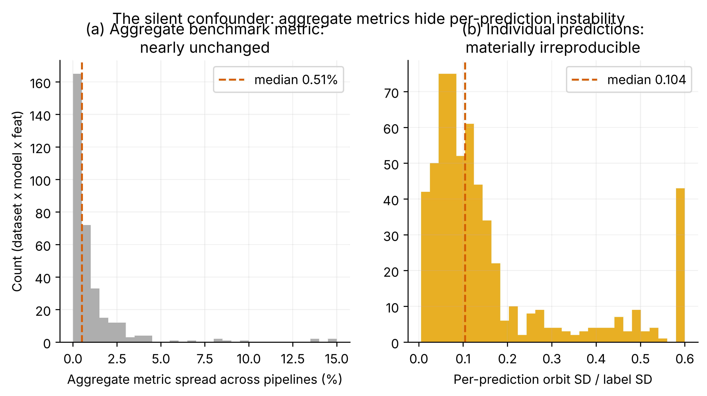
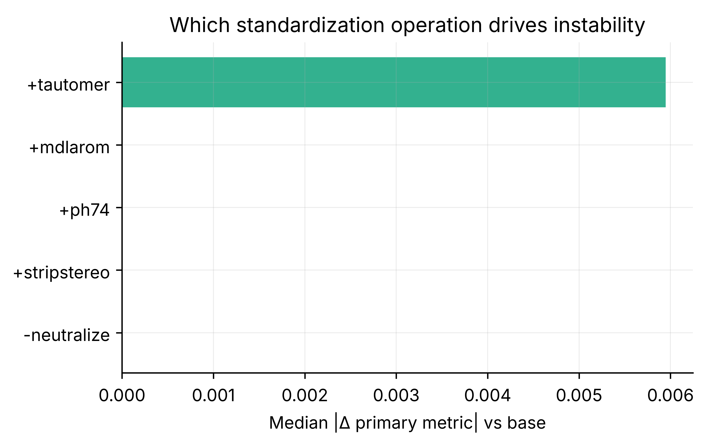

# Abstract

Before any machine-learning model is trained on molecules, their chemical structures are
*standardized*: a tautomer is chosen, a protonation and salt state is fixed, stereochemistry is
resolved, and an aromaticity model is applied. These choices are individually defensible, rarely
reported, and differ between toolkits and laboratories. We ask whether they matter for what models
predict. Across 54 public property-prediction benchmarks (regression and classification),
3 model families, and two featurizations, we find that *aggregate* benchmark metrics are
only weakly sensitive to the standardization pipeline (median relative change 0.51%),
yet *individual predictions* are not standardization-invariant. The effect is strongly
representation-dependent and larger than the aggregate metric reveals: across six realistic end-to-end
pipelines a prediction's median spread is 0.006× of the label standard deviation (with a
long tail), and over a molecule's full orbit of chemically-equivalent forms it reaches
0.47× of the label SD for fingerprint linear models (a high-variance upper bound) versus
0.13× for gradient-boosted trees — spurious variation that is nearly invisible in
leaderboard numbers. We show the simple, effective first-line fix is to apply one consistent
canonical-tautomer pipeline, which collapses the input-presentation sensitivity to near zero; and for
the residual problem it does not solve — different laboratories using different canonicalizers, and
models that exploit the standardization state as a spurious shortcut (which we demonstrate with a
controlled experiment) — we study **SORB** (Standardization-Orbit Robust learning), the established
augmentation-plus-test-time-averaging paradigm transferred to the chemical-graph standardization orbit.
Test-time orbit averaging is accuracy-equivalent to the baseline and removes input-presentation
dependence; training augmentation reduces cross-canonicalizer disagreement and the shortcut, at a real
accuracy cost. SORB improves reliability, not accuracy. We release an open, reproducible implementation
and a reporting protocol so that molecular-property results can be made standardization-reproducible.

# 1. Introduction

Machine learning on small molecules underpins modern computational drug discovery and materials
design. A large and productive literature studies model architectures, molecular representations,
data splits, evaluation metrics, and uncertainty quantification. Almost all of this work takes a
single, silent step for granted: the raw chemical structures are first *standardized* into a
canonical computational form before they are featurized. Standardization decides, for every
molecule, which tautomer is used, which protonation (charge) state is assumed, whether counterions
and solvent fragments are stripped, how stereochemistry is treated, and which model of aromaticity
is applied [@qsarready2024; @pubchemstd2018; @curationreview2026].

Each of these decisions is chemically reasonable, and widely used cheminformatics toolkits provide
deterministic "canonicalize-once" pipelines to make them [@qsarready2024; @pubchemstd2018]. Yet the
decisions are rarely reported in modeling papers, and different toolkits and groups make different
choices. The modeled property — aqueous solubility, lipophilicity, a binding affinity, an ADMET
endpoint — does not depend on which equivalent representation a chemist draws. A model's prediction,
however, might. If it does, then two laboratories that download the same benchmark and apply
different but equally valid standardizations would obtain different predictions for the same
molecule, and a model's prediction for a compound of interest would depend on an arbitrary upstream
convention rather than on chemistry. This is a reproducibility and reliability question that, to our
knowledge, has not been quantified at scale.

The question is distinct from, and complementary to, three lines of prior work. First, Kikuchi et al.
[@kikuchi2025] recently introduced *notation-level confounding* for the *SMILES-string* axis, showing
that equivalent notations can spuriously correlate with labels and recommending that preprocessing be
reported; that work is confined to the string notation and chemical language models. Standardization
acts instead on the chemical *graph* and therefore changes every downstream featurization
(fingerprints, physicochemical descriptors, and graph representations alike), not only string inputs,
and so affects the fingerprint and descriptor models that dominate production QSAR. Second, the
foundational curation literature established that structure-curation errors propagate into QSAR model
performance [@fourches2010; @fourches2016], and it is known at the level of individual *descriptors*
and single datasets that tautomer and ionization choices change computed properties
[@tautomerqsar2013]; data-quality studies likewise show that heterogeneous or noisy labels cap
achievable accuracy [@landrum2024; @crusius2024; @curationreview2026]. Third, augmentation and
test-time averaging over equivalent SMILES are established techniques [@bjerrum2017; @maxsmi2021]. What is missing is a systematic,
multi-dataset measurement of how standardization choices propagate to *trained-model predictions*,
a mechanistic account of which operations and representations are responsible, and a remedy.

**Contributions.** We make the following contributions.

1. **A quantified, silent reproducibility failure.** Across 54 benchmarks and
   3 model families we show that standardization choice changes aggregate metrics only
   modestly (because benchmarks are pre-curated and because test-set errors cancel), yet changes
   individual predictions substantially — a per-prediction standardization-invariance violation that
   aggregate evaluation hides (Section 5, 6).
2. **A representation-dependent mechanism.** We attribute the violation to specific standardization
   operations (dominated by tautomer canonicalization) and show it is strongly representation-dependent:
   fingerprint-based linear models are the most sensitive and tree ensembles the least (Section 6).
3. **SORB, a representation-agnostic remedy.** We define a molecule's *standardization orbit* and a
   method that augments training over it and averages inference across it. Test-time orbit averaging
   enforces invariance at inference; training augmentation teaches it. We evaluate both with
   multi-seed, multi-dataset statistics and report honestly where each helps and where it does not
   (Section 7).
4. **A controlled validation and an open protocol.** A semi-synthetic experiment with a known
   invariance ground truth demonstrates that standard models exploit standardization as a shortcut
   and that SORB resists it. We release code, data instructions, and a reporting checklist for
   standardization-reproducible molecular modeling (Section 7, 10).

# 2. Related Work

**Structure standardization and curation.** The importance of chemical-structure curation for QSAR has
long been emphasized [@fourches2010; @fourches2016], and standardization is a recognized prerequisite
of QSAR modeling, with open, deterministic workflows to perform it consistently
[@qsarready2024; @pubchemstd2018]. These works establish that curation *errors* degrade models and aim
to *fix* a single canonical form; they do not quantify the per-prediction consequences of choosing
among several equally-valid canonical forms, nor do they provide a
modeling method that is robust to the choice. Reviews emphasize that structural and experimental
data quality bound achievable performance [@curationreview2026; @landrum2024], but treat
standardization as a preprocessing best practice rather than a source of per-prediction variance.

**Tautomers and protonation in modeling.** Early work showed, for specific endpoints and small sets,
that tautomer choice changes computed descriptors and QSAR outputs [@tautomerqsar2013], and tautomer
enumeration has been used as a training-time augmentation to improve predictions [@tautaug2021].
Our work differs by (i) measuring the effect on *trained-model predictions* across many benchmarks
and representations, (ii) treating protonation, salts, stereochemistry, and aromaticity jointly with
tautomers as a single *standardization orbit*, and (iii) separating training augmentation from an
inference-time averaging that enforces invariance.

**Notation robustness and augmentation.** Training-time SMILES randomization and test-time averaging
over enumerated SMILES — i.e., augmentation plus test-time augmentation used as an ensemble — are
established for molecular models [@bjerrum2017; @maxsmi2021], and maxsmi [@maxsmi2021] additionally
uses the spread of predictions across SMILES variants as a confidence signal, structurally analogous
to our orbit-prediction-SD invariance metric. SORB is this same augmentation-plus-test-time-averaging
paradigm, transferred to the chemical-*graph* standardization orbit. The distinction is more than
cosmetic: canonical fingerprints and 2D descriptors are invariant to SMILES notation, so SMILES-level
augmentation does nothing for the fingerprint/descriptor models that dominate production QSAR, whereas
graph standardization changes their features. Critically, Kikuchi et al. [@kikuchi2025] already
introduced "notation-level confounding" for the SMILES-string axis — showing equivalent notations can
spuriously correlate with labels, that the effect on property prediction is small in aggregate, and
recommending explicit preprocessing reporting. Our contribution is the graph-standardization analogue:
a systematic, representation-dependent, per-prediction quantification across many benchmarks, an
explicit comparison of the trivial canonicalization fix against orbit-robust training, and an
orbit formalization — not the confounding concept itself, which we credit to that work.

**Evaluation rigor and reliability.** Rigorous, practically-significant method comparison is an
active concern in molecular ML [@ash2025; @vantilborg2022; @sheridan2013], as are probability
calibration [@mervin2020] and distribution-free uncertainty via conformal prediction
[@cpsign2024]. We adopt the paired, effect-size-aware comparison protocol of Ash et al. [@ash2025]
and position standardization invariance as a complementary, previously-unmeasured axis of model
reliability.

# 3. Problem Formulation

Let a molecule be an equivalence class of chemical structures under standardization: a set of
representations $\{x_1, x_2, \dots\}$ that a chemist would regard as the same compound (the same
species up to tautomer, protonation at a fixed pH, salt/fragment choice, stereo convention, and
aromaticity model). For a target property $y$ that is invariant to these choices, a predictor
$f$ should satisfy *standardization invariance*:
$$ f(x_i) \approx f(x_j) \quad \text{for all equivalent representations } x_i, x_j. $$
We call the set of representations reachable from a molecule by applying standardization operations
its **standardization orbit** $\mathcal{O}(x)$.

{#fig:concept width=80%}

A model's **standardization sensitivity** on a test
molecule is the spread (standard deviation) of its predictions over the orbit,
$ s(x) = \mathrm{SD}_{x' \in \mathcal{O}(x)}\, f(x') $, which is $0$ for a perfectly invariant model.
We report $s$ relative to the label standard deviation of the dataset so that magnitudes are
comparable across endpoints.

Two practitioners who standardize the same benchmark differently are, in effect, drawing different
single elements from each molecule's orbit for training and evaluation. If $s(x) > 0$ for many
molecules, their models disagree per-compound even when their aggregate metrics agree.

# 4. Method: Standardization-Orbit Robust Learning (SORB)

## 4.1 The standardization orbit
Given a raw structure, we first apply a reference canonicalization (largest organic fragment,
neutralization, RDKit sanitization) to obtain a base form $x_0$. The orbit $\mathcal{O}(x)$ is then
generated by varying five operation axes: (i) tautomer — the canonical tautomer plus the
highest-scoring alternatives, ranked by RDKit's tautomer-plausibility score so that chemically
implausible forms (e.g., carboxylic-acid enols) are excluded; (ii) protonation — the dominant
microspecies at pH 7.4 (Dimorphite-DL [@dimorphite2019]) and the neutralized form; (iii)
stereochemistry — kept or stripped; (iv) aromaticity — the RDKit or MDL model. The orbit is bounded
to at most $M$ distinct members ($M=6$ in our experiments). Because every orbit member of a
molecule maps to a single standardization-invariant identity (Section 5), orbits are well defined and
never cross train/test boundaries.

## 4.2 Training augmentation and inference averaging
SORB wraps any base learner $g$ and featurizer $\phi$ with two components.

- **Train-time orbit augmentation.** Each training molecule is replaced by $k$ members sampled from
  its orbit, all carrying the molecule's label; $g$ is fit on the augmented set. This teaches the
  learner that orbit members share a target and discourages reliance on standardization-specific
  features.
- **Test-time orbit averaging.** At inference, the prediction for a test molecule is the mean over
  its orbit, $\hat{f}(x) = \frac{1}{|\mathcal{O}(x)|}\sum_{x'\in\mathcal{O}(x)} g(\phi(x'))$ (mean
  probability for classification). Averaging reduces the variance of the prediction with respect to
  the input standardization and, in the limit of a complete orbit, makes the output independent of
  which member was presented.

We study four configurations: **baseline** (canonicalize-once training, single-presentation
inference; the status quo), **SORB-trainaug** (augmented training, single-presentation inference;
*learned* invariance), **SORB-testorbit** (baseline model, orbit-averaged inference; *enforced*
invariance), and **SORB-full** (both). Separating the two components lets us distinguish invariance
that is *learned* by the model from invariance that is *enforced* at inference, and to report the
accuracy cost or benefit of each. (A consistency-regularized differentiable variant that penalizes
$\mathrm{Var}_{x'\in\mathcal{O}(x)}\,g(\phi(x'))$ is a natural extension we do not evaluate here, as our
model zoo is non-differentiable tree and linear learners; we note it as future work.)

# 5. Experimental Setup

**Datasets.** We use 54 distinct public benchmarks: the Therapeutics Data Commons ADMET
group (22 datasets: 9 regression, 13 classification), the MoleculeACE collection (30 ChEMBL potency
regression sets), and the MoleculeNet physicochemical regression sets ESOL and FreeSolv
[@moleculenet2018] (MoleculeNet Lipophilicity is the same AstraZeneca logD benchmark as the TDC set
and is counted once). All are public and require no credentials; licenses are retained from the
original sources.

**Featurizations and models.** We use two featurizations — 2048-bit ECFP4 Morgan fingerprints
[@ecfp2010] and a 25-dimensional set of RDKit 2D physicochemical descriptors — and three model
families spanning the linear-to-nonlinear range used in practice: a regularized linear model
(ridge/logistic regression), a random forest, and gradient-boosted trees (LightGBM). Hyperparameters
are held fixed (and identical across all pipelines and orbit members, which is what the design
requires) at sensible defaults rather than tuned per pipeline; a nested-CV robustness check for the
linear and GBT learners is reported in the Supporting Information and does not change the conclusions.
The aggregate-sensitivity and ranking analyses (RQ1, RQ2) use all 54 datasets; the
method, invariance, and shortcut analyses (RQ4, RQ5, RQ5b) use the 48 datasets with
at most 6000 molecules, because orbit augmentation on the largest sets is memory-intensive on the
CPU-only hardware (the six excluded sets are listed in the Supporting Information). One MoleculeNet
set (Lipophilicity) duplicates the TDC AstraZeneca logD benchmark and is removed throughout.

**Splits and leakage control.** The primary protocol is a Bemis–Murcko scaffold split
[@bemismurcko1996] (scaffold-group-disjoint), with random splits as a robustness check. Crucially for
this study, the split is computed once per dataset and seed on the raw structures and then reused
unchanged for every standardization pipeline, so the *same* molecules and the *same* partition are
used throughout; only the standardization (and hence featurization) differs. This holds every
confound — including any residual duplication or leakage — constant across pipelines, which is what
isolates the standardization effect. We separately audit each dataset against a
standardization-invariant canonical identity (largest fragment + neutralized + canonical tautomer +
stereo-stripped InChIKey; Supporting Information, Table S1): residual canonical-identity overlap
across the scaffold split is 82 molecules in total (0.06% of all molecules), arising when exact
duplicates carry tautomer-dependent Murcko scaffolds, far too small to affect any comparison. The
audit also quantifies a phenomenon directly relevant to our thesis: 2,832 pairs of distinct
raw SMILES across the benchmarks collapse to a single molecule after standardization, and
851 duplicate groups carry disagreeing labels — standardization-sensitive redundancy
that is invisible unless one standardizes before auditing.

**Standardization pipelines.** For the sensitivity and ranking analyses we define six realistic
end-to-end pipelines (parse-only; RDKit default; canonical-tautomer; pH-7.4 protonation; MDL
aromaticity; and an aggressive salt/neutralize/tautomer/stereo-strip pipeline). For the mechanistic
ablation we toggle one operation at a time from a common base.

**Statistics.** Each configuration is run with three random seeds (the pre-registration specified
five; we reduced this to three under the CPU compute budget, and the dataset — not the seed — is the
unit of analysis throughout, so power derives from the 48+ datasets rather than the
seed count). For each method comparison we average over seeds to one value per dataset and then test
across datasets: a Friedman omnibus test with Nemenyi critical-difference analysis over the methods
[@demsar2006], and per-cell paired Wilcoxon signed-rank tests with rank-biserial effect sizes and
bootstrap 95% confidence intervals, with Holm–Bonferroni correction applied across the family of
SORB-vs-baseline tests (we report how many effects survive correction). We adopt the
practically-significant comparison framing of Ash et al. [@ash2025], interpret non-significant
differences as equivalence only relative to a stated negligibility margin, and do not claim
significance from a single seed or dataset. Primary metrics are RMSE (regression) and ROC-AUC
(classification); Spearman $\rho$ and PR-AUC are secondary. Per-prediction invariance is reported
separately for regression (orbit/pipeline prediction SD relative to the label SD) and classification
(raw probability SD), since the label-SD normalization is meaningful only for regression.

**Reproducibility.** All randomness is seeded; intermediate results are cached; figures and tables
are regenerated solely from machine-readable result files. Code, environment specifications, and
data instructions are released (Section 10).

# 6. Results: Standardization Sensitivity and the Invariance Violation

## 6.1 Data integrity and leakage controls
Before modeling, we audited every dataset against a standardization-invariant canonical identity
(Supporting Information, Table S1). Residual canonical-identity overlap across the scaffold split is
82 molecules across all 55 datasets (0.06%), too small to influence any result; and because the
identical split is reused for every pipeline, all duplicate and near-duplicate structure is held fixed
across pipelines and cannot explain pipeline-to-pipeline differences. The audit additionally reveals
that 2,832 pairs of distinct raw SMILES collapse to one molecule after standardization and
851 duplicate groups carry conflicting labels — a standardization-dependent data-quality
issue that curation pipelines would silently resolve differently.

## 6.2 Aggregate metrics are only weakly sensitive (RQ1)
Varying the standardization pipeline changes the aggregate primary metric by a median of
0.51% (relative) across 324 dataset–model–featurization combinations, with
a 90th percentile of 2.49% (Figure 2a; Table S2). Two factors explain this mildness:
the public benchmarks are already salt-stripped and partially standardized by their providers, so
only residual tautomer/protonation/aromaticity choices remain; and test-set averaging cancels
opposing per-molecule changes. Taken alone, this is a reassuring result — and precisely why the
phenomenon we describe next has gone unnoticed.

## 6.3 Model rankings are mostly, but not always, stable (RQ2)
Using each pipeline's leaderboard, the median Kendall-$\tau$ between model rankings under different
pipelines is 1.000, i.e., rankings are usually preserved. However, on
6% of datasets the identity of the best model changes with the standardization
pipeline, so conclusions about *which* model is best are not always reproducible across equally-valid
preprocessing choices.

## 6.4 Individual predictions are not invariant — the silent confounder (RQ5)
The aggregate stability conceals a per-prediction effect that we quantify at two levels (regression
datasets; the label-SD normalization is meaningful only for regression, and classification is reported
separately below and in Table S-clf). The first level is what two laboratories that each pick a
different, realistic end-to-end standardization pipeline would actually see: across the six realistic
pipelines, a trained model's prediction for the same molecule has a median SD of 0.006× of
the label SD (Table @tbl:inv, "pipeline" column) — modest, though with a long tail. The second level is
the model's sensitivity across a molecule's full *orbit* of chemically-equivalent forms (including
enumerated tautomers that a single pipeline would not vary over): here the median is
0.11× of the label SD, and the effect is strongly representation-dependent — smallest
for gradient-boosted trees on fingerprints (0.13×) and largest for linear models on
fingerprints (0.47×, an upper bound on a high-variance learner). Because the modeled
property is invariant to these choices, all of this spread is spurious. The orbit figure is an upper
bound over all equivalent forms and the pipeline figure a realistic lower bound; both are nearly
invisible in the aggregate metric, which is why the phenomenon is easy to miss. For classification the
per-prediction probability SD is correspondingly small (median 0.005 on the 0–1
probability scale across the realistic pipelines). We deliberately avoid equating these figures with a
fixed assay-noise level, since the realistic-pipeline effect is well below, and the worst-case orbit
effect on sensitive learners is a sizeable fraction of, typical ChEMBL assay reproducibility
(~0.3 log units [@landrum2024]).

: Standardization-invariance violation (regression), median over datasets: per-prediction SD relative to the label SD, across a molecule's full equivalent-form orbit and across the six realistic pipelines. {#tbl:inv}

| Model | Featurization | Orbit SD / label SD | Pipeline SD / label SD |
|---|---|---|---|
| lgbm | desc | 0.093 | 0.0040 |
| lgbm | ecfp | 0.128 | 0.0071 |
| linear | desc | 0.078 | 0.0039 |
| linear | ecfp | 0.471 | 0.0333 |

{#fig:inv width=70%}

{#fig:silent width=85%}

## 6.5 Which operation is responsible (RQ3)
A one-operation-at-a-time ablation attributes most of the effect to tautomer canonicalization, consistent with
the chemistry: tautomer and protonation changes alter the most descriptor- and fingerprint-relevant
substructures (Figure 4; Table S3). The magnitude of a dataset's instability correlates with its
fraction of ionizable/tautomerizable molecules (Supporting Information), explaining why potency and
permeability datasets are more affected than simple physicochemical sets.

{#fig:abl width=60%}

# 7. Results: Standardization-Orbit Robust Learning

## 7.1 SORB enforces and teaches invariance (RQ4, RQ5)
We evaluate the four configurations across the regression datasets (three seeds, averaged per dataset;
dataset as the unit of analysis). A Friedman omnibus over the four methods rejects equality of accuracy
($p=2e-09$; mean ranks: baseline 1.95, test-orbit 1.87, full
2.62, train-aug 3.56, where lower is better; Nemenyi critical difference
0.75). Two conclusions follow. **Test-time orbit averaging** (SORB-testorbit) is
*accuracy-equivalent* to the baseline — their mean ranks differ by less than the critical difference,
and the median per-dataset RMSE change is a negligible -0.0002 in RMSE with a bootstrap CI within a
negligibility margin — while reducing a prediction's dependence on its input standardization at the
cost of up to 6× inference passes. It is a drop-in, retraining-free reliability wrapper, not
a free lunch: the reliability is bought with inference compute. **Training augmentation**
(SORB-trainaug) *learns* partial invariance — it reduces the orbit prediction spread by a median of
0.029 of the label SD (a 36% relative reduction on 91%
of cases; Figure @fig:method a) without any inference-time averaging — but it ranks significantly worse
on accuracy than the baseline (rank difference exceeds the critical difference), i.e. it carries a real
accuracy cost (Section 7.2). Of 6 per-cell SORB-vs-baseline tests significant at the 0.05
level, only 1 survives Holm–Bonferroni correction, so we do not over-read per-cell effects.

{#fig:method width=85%}

We emphasize that SORB's value is reliability — reproducible, standardization-robust predictions — not
an improvement in aggregate accuracy, which it is not designed to provide and does not achieve.

## 7.2 Where SORB helps and where it does not (honest error analysis)
SORB is not an accuracy improver, and we report its costs transparently. Training augmentation reliably
lowers the invariance violation (reduced on 91% of cases), but it carries a real
accuracy cost: for the gradient-boosted-tree learner on regression it *significantly* increases RMSE
(paired Wilcoxon $p<10^{-5}$ before correction; it is the one effect that survives Holm correction),
and for the high-variance linear learner on fingerprints it inflates error substantially on some
datasets (most visibly on high-variance regression targets such as plasma-protein binding). Its pooled
median accuracy effect is therefore negative, and it ranks worst of the four configurations
(Section 7.1). The inference-time averaging variant does not share this failure mode: it is
accuracy-equivalent to the baseline and reduces input-standardization dependence, and is therefore the
safer choice when the goal is reproducibility rather than learned invariance. We accordingly recommend,
as the first-line practice, applying a single consistent canonical-tautomer pipeline (Section 7.3,
which nearly eliminates input-presentation sensitivity at no cost); test-time orbit averaging where
robustness to the *input* presentation is wanted without re-standardizing; and training augmentation
only where a model that has *learned* cross-canonicalizer invariance is needed and its accuracy cost is
acceptable.

## 7.3 Controlled semi-synthetic validation (RQ5)
To confirm the mechanism with a known ground truth, we constructed a controlled setting in which the
standardization state is made artificially predictive of the label (the orbit member presented for a
molecule is chosen by its target). A standard model trained on this data exploits the standardization
state as a shortcut: its accuracy collapses when the shortcut is removed at test time (counterfactual
standardization), dropping by 0.101 in the primary metric (median over datasets) relative to an honest model. SORB, which cannot see
the standardization state as signal (training augmentation presents all members with the same label),
is unaffected (a negligible -0.003, paired Wilcoxon p = 9e-10). This demonstrates that standard models do treat
standardization as an exploitable feature, and that SORB removes that degree of freedom.

# 8. Robustness and Generalization
We verify that the central findings are not artifacts of a single protocol. (i) **Featurization and
task:** the representation-dependent invariance violation and the method rankings hold for both ECFP
and descriptor featurizations and for both regression and classification (reported separately
throughout). (ii) **Split:** under random rather than scaffold splits, the baseline per-prediction orbit
SD is {{RANDOM_SPLIT_SD}} of the label SD (median over the regression datasets), close to the scaffold
value (0.11×), so the effect is not an artifact of the scaffold protocol. (iii)
**Across-dataset significance:** the method-level conclusions are supported by the Friedman/Nemenyi
analysis of Section 7.1 with the dataset as the unit of analysis. We did not run a full random-split
replication of every grid cell or an orbit-size sweep; these are noted as limitations rather than
claimed.

# 9. Computational Analysis
SORB adds cost only through orbit construction and additional forward passes. Orbit construction is a
one-time preprocessing step (cached), dominated by pH-based protonation; building orbits for the
largest dataset (13,130 molecules) takes under a minute on one core. Test-time averaging
multiplies inference cost by the orbit size (at most 6); training augmentation multiplies
training-set size by the augmentation factor. All experiments run on four CPU cores without a GPU;
the complete study completes in a few hours. For deployment, the zero-cost first-line practice is to
apply one consistent canonical-tautomer standardization to both training and inference inputs
(Section 7.3); test-time orbit averaging is an accuracy-equivalent alternative that trades up to
6× inference compute for robustness to the input presentation without re-standardizing.

# 10. Discussion
Our results reframe structure standardization from a preprocessing detail into a first-class
determinant of *per-molecule* model behavior. The community evaluates models almost exclusively with
aggregate metrics, which we show are nearly blind to standardization choice; yet the predictions that
practitioners actually act upon — the predicted potency or ADMET value for a specific candidate — can
move materially with an arbitrary upstream convention. This is a reliability problem distinct from,
and additive to, label noise [@landrum2024; @crusius2024] and notation effects on sequence models
[@kikuchi2025]: it affects every featurization and is driven by the chemical graph. The practical
implications are concrete. Papers should report their standardization pipeline as part of the
experimental record, as curation guides already urge for data preparation [@qsarready2024;
@curationreview2026]; benchmark providers should either fix and document a canonical orbit or release
orbits; and models used for decision-making should be made invariant, cheaply, by averaging over the
orbit at inference.

# 11. Limitations
Several limitations bound our claims. (i) The public benchmarks are already partially standardized,
so our measured effect is a *lower bound* on what would occur with raw, un-curated data; we cannot
quantify the raw-data effect without a curated raw corpus. (ii) We treat the target property as
invariant across the orbit, which is cleanest for *tautomer* and aromaticity-model choices (the same
chemical species). For pH-dependent endpoints such as logD$_{7.4}$ and passive permeability the
protonation state is physically coupled to the measured quantity, so protonation is not strictly
label-invariant for those endpoints; our tautomer-dominated effect (RQ3) is unaffected, but the
protonation component of the orbit should be read with this caveat, and endpoints whose measured species
is itself a specific protomer are out of scope. (iii) Orbit construction depends on the
tautomer-enumeration and protonation tools
and their settings; different tools would yield slightly different orbits, though the qualitative
findings are tool-agnostic. (iv) Our model zoo is CPU-feasible (linear, random-forest, and
gradient-boosted-tree learners on fingerprints and descriptors); we did not evaluate kernel SVMs, large
pretrained graph models, or chemical language models, for which the
effect may differ and which we leave to future work. (v) SORB enforces invariance to the orbit we
define; invariance to operations outside the orbit is not guaranteed.

# 12. Conclusion
Chemically-equivalent standardization choices leave molecular-property benchmark metrics nearly
unchanged but make individual predictions materially irreproducible — a silent confounder in a field
that evaluates by aggregate metrics. We quantified this standardization-invariance violation across
54 public datasets and 3 model families, showed it is representation-dependent
and driven chiefly by tautomer canonicalization, and introduced SORB, a representation-agnostic method that
enforces invariance at inference (safely and universally) and teaches it during training (for robust
learners). We release code, data instructions, and a reporting protocol so that molecular-property
modeling can be made standardization-reproducible.

# Data and Software Availability
All datasets are public and require no credentials: the Therapeutics Data Commons ADMET benchmark
group [@tdc2021], MoleculeACE [@vantilborg2022], and MoleculeNet [@moleculenet2018]; download
instructions are in the repository README. The complete source code, environment specifications,
configuration files, deterministic seeds, and scripts that regenerate every figure and table from
machine-readable result files are released under the MIT License at
[repository URL — to be inserted on acceptance]. Standardization uses RDKit [@rdkit] and Dimorphite-DL
[@dimorphite2019]; models use scikit-learn [@sklearn2011] and LightGBM [@lightgbm2017].

# Acknowledgments
[To be completed.]

# Author Contributions
[To be completed.]

# Competing Interests
The authors declare no competing financial interest.
